<div align="center">

# Registro de Tiempo de Personal

**Control de asistencia para Android con validación facial, geocercas GPS y cálculo de pagos según la ley peruana.**


-FFA000)

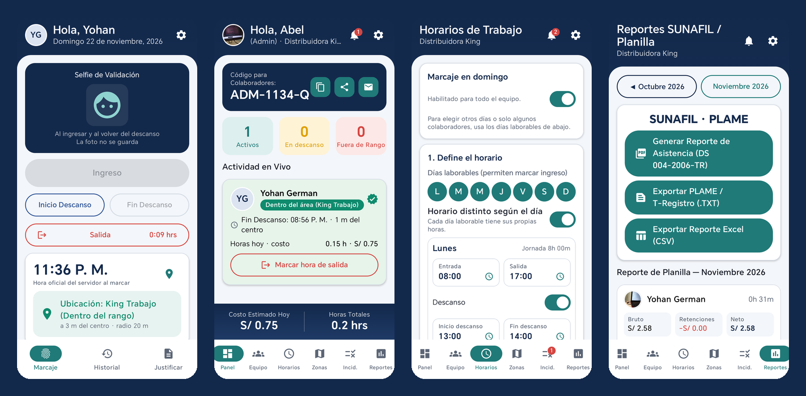

</div>

---

## ¿Qué hace?

El colaborador marca su asistencia desde el celular y la app verifica que **es él** (rostro en vivo) y que **está en el lugar de trabajo** (GPS dentro de la geocerca). El administrador ve al equipo en tiempo real, recibe alertas, revisa justificaciones y obtiene el pago de cada persona calculado automáticamente.

- **Sin guardar fotos:** el rostro se analiza en la memoria del teléfono y se descarta al instante.
- **Hora a prueba de trampas:** cada marcaje usa la hora del servidor de Google, no la del celular.
- **Costo cero de infraestructura:** funciona dentro del plan gratuito de Firebase.

## Funciones

### Para el colaborador

| | |
| :-- | :-- |
| **Marcaje en 4 eventos** | Ingreso, inicio de descanso, fin de descanso y salida. Se pide selfie en vivo al ingresar y al volver del descanso. |
| **Ubicación verificada** | Indicador tipo semáforo: “Dentro del rango · a 3 m del centro”. Bloquea GPS simulado (*mock location*). |
| **Ganancia en tiempo real** | Horas del día, pago del día y acumulado del mes. |
| **Justificaciones** | Ve sus incidencias (tardanza, salida anticipada, descanso fuera de horario…) y envía el motivo; también puede pedir permiso para otra fecha. |
| **Historial y boleta** | Días trabajados y boleta mensual proyectada en PDF. |

### Para el administrador

| | |
| :-- | :-- |
| **Panel en vivo** | Quién está dentro del área, en descanso, fuera de rango o con tardanza; horas y costo del día. Puede marcar la salida de un colaborador que la olvidó. |
| **Centro de notificaciones** | Alertas de GPS falso, marcajes fuera de zona, tardanzas e incidencias. Se marcan como leídas y el contador se actualiza. |
| **Horarios flexibles** | Días laborables de lunes a domingo, tolerancia y **horario distinto por día** (p. ej. lunes en la mañana, martes en la tarde, domingo en la mañana), con o sin descanso. |
| **Alertas por tolerancia** | Pasada la tolerancia (5 min por defecto) se genera una incidencia que el colaborador debe justificar: ingreso tarde, descanso antes o después de lo programado, retorno tardío y salida antes o después del horario. |
| **Geocercas** | Mapa de Google para fijar la sede y el radio de cobertura (5 m a 150 m). |
| **Gestión del equipo** | Código de empresa para invitar (`ADM-XXXX-X`), alta, baja, desvinculación y eliminación de cuentas. |
| **Reportes** | Asistencia SUNAFIL (DS 004-2006-TR), PLAME / T-Registro (.TXT), Excel (CSV) y reporte de costos en PDF. |

## Dos formas de pagar

| | **Modo Simple** (MYPES) | **Modo Avanzado Perú** |
| :-- | :-- | :-- |
| Base | Tarifa por hora | Sueldo mensual (valor hora = sueldo ÷ 240 h) |
| Horas extras | A la **misma tarifa**, sin recargo | **+25 %** las 2 primeras horas del día y **+35 %** desde la tercera |
| Descuentos | Ninguno | ONP 13 % o AFP (aporte, prima y comisión), Renta de 5.ª categoría |
| Empleador | — | EsSalud 9 %, CTS y gratificaciones (provisión mensual) |
| Regímenes | — | Régimen General y REMYPE (micro y pequeña empresa) |
| Extras | — | Asignación familiar (10 % de la RMV) |

> Los parámetros legales (RMV, UIT, tasas AFP/ONP y tramos de 5.ª) están en `ParametrosLegales` dentro de `PlanillaPeruCalculator.kt`. **Revísalos cada año**; la boleta es referencial.

## Capturas

<table>
  <tr>
    <td align="center">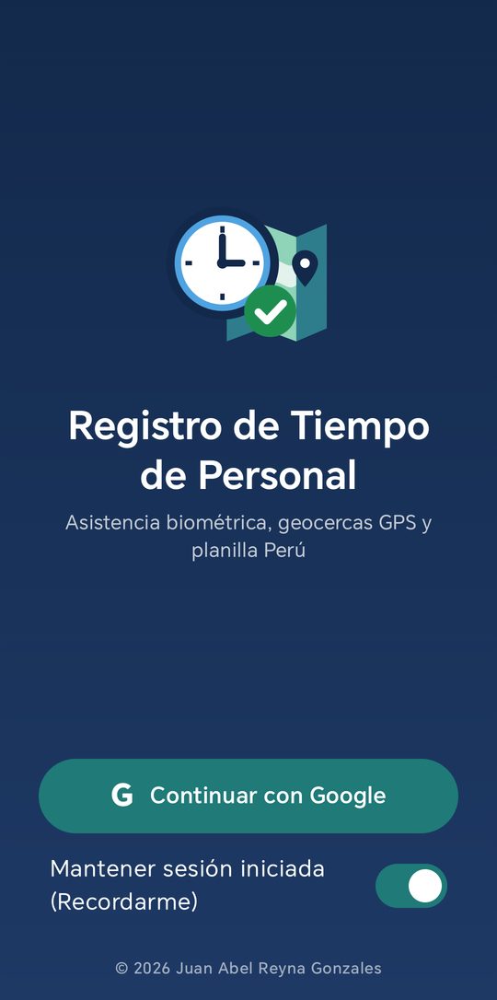<br><sub>Acceso con Google</sub></td>
    <td align="center">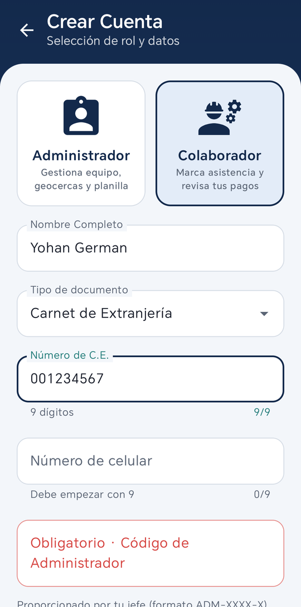<br><sub>Registro (DNI / C.E.)</sub></td>
    <td align="center">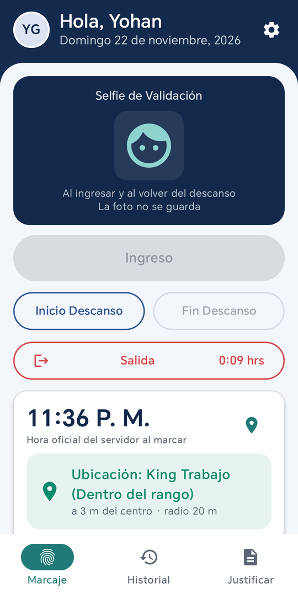<br><sub>Marcaje del colaborador</sub></td>
    <td align="center">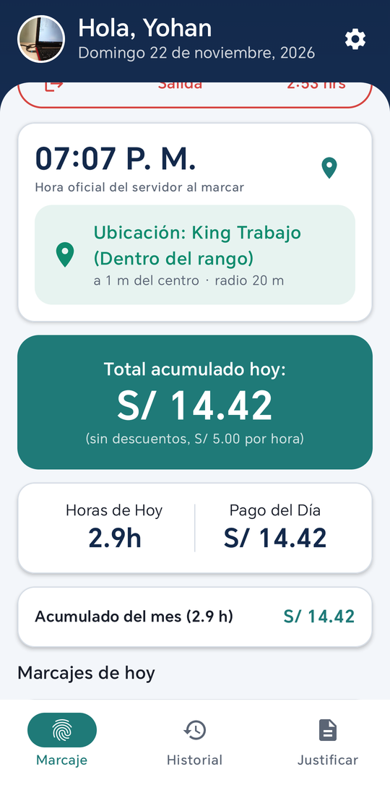<br><sub>Ganancia del día</sub></td>
  </tr>
  <tr>
    <td align="center">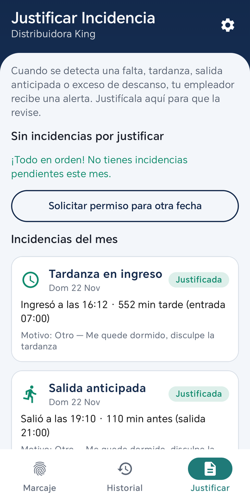<br><sub>Justificar incidencias</sub></td>
    <td align="center">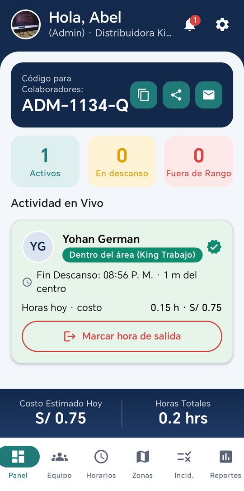<br><sub>Panel del administrador</sub></td>
    <td align="center">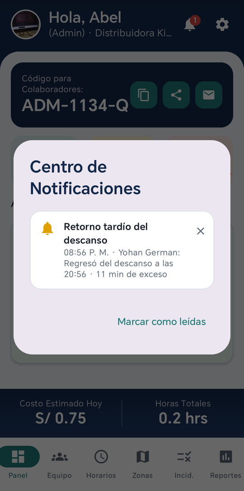<br><sub>Centro de notificaciones</sub></td>
    <td align="center">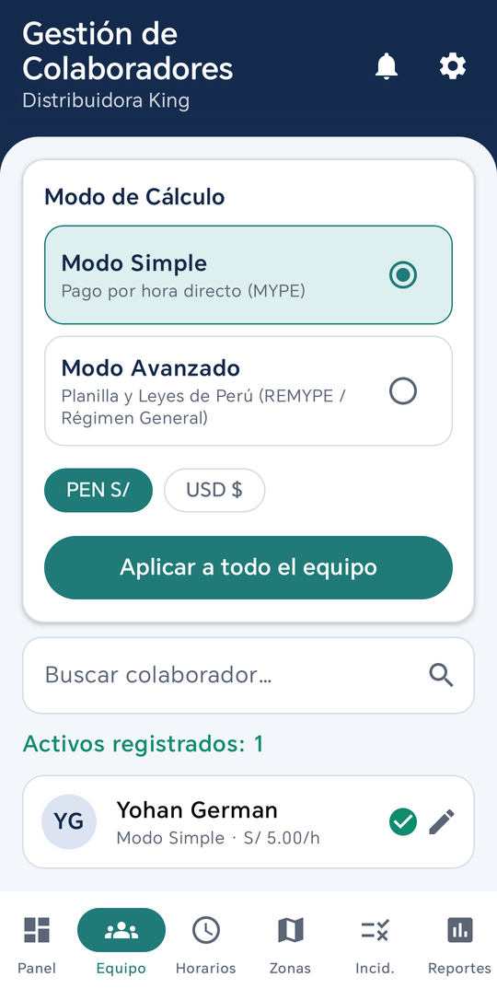<br><sub>Gestión de colaboradores</sub></td>
  </tr>
  <tr>
    <td align="center">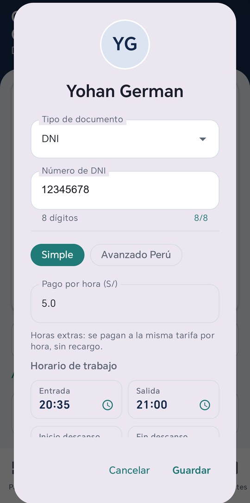<br><sub>Ficha del colaborador</sub></td>
    <td align="center">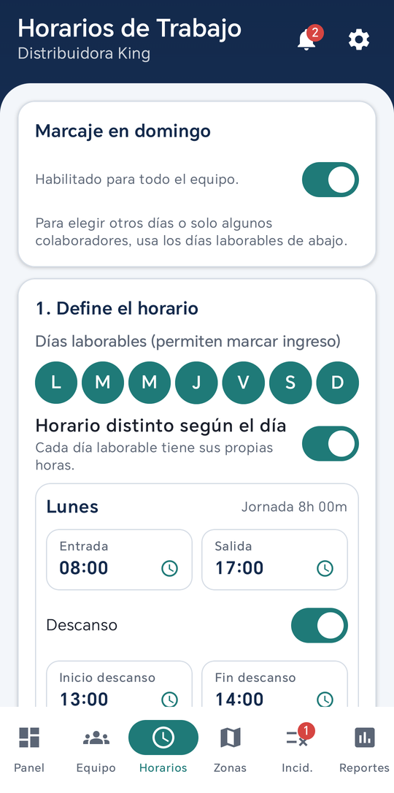<br><sub>Horario distinto por día</sub></td>
    <td align="center">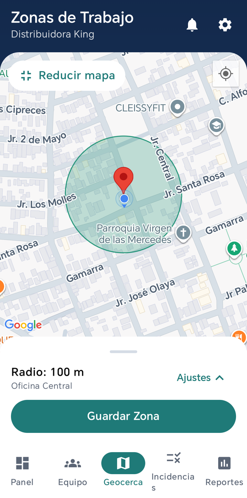<br><sub>Geocerca</sub></td>
    <td align="center">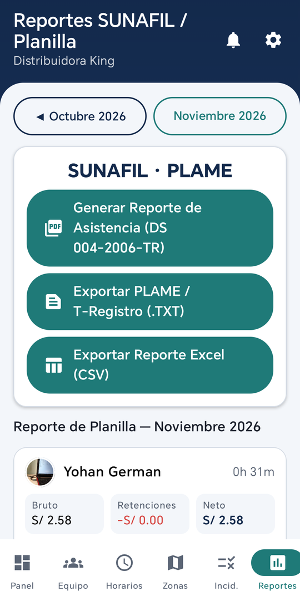<br><sub>SUNAFIL · PLAME</sub></td>
  </tr>
  <tr>
    <td align="center">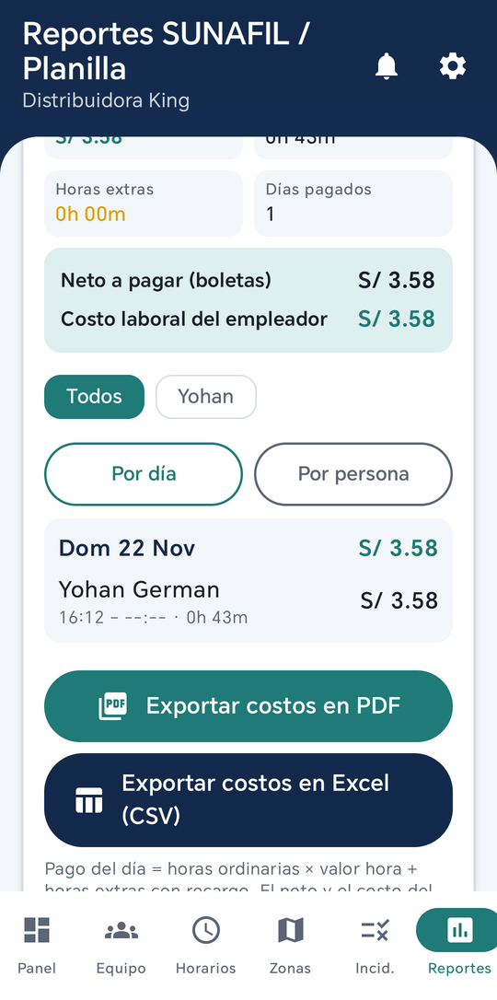<br><sub>Reporte de costos</sub></td>
    <td align="center">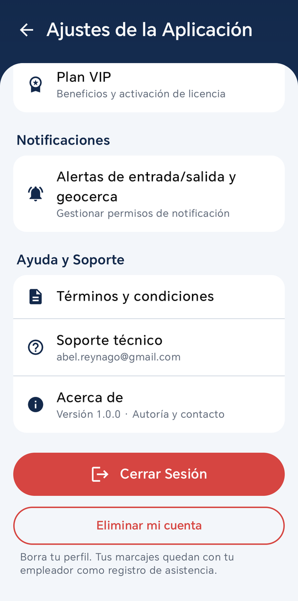<br><sub>Ajustes</sub></td>
    <td></td>
    <td></td>
  </tr>
</table>

## Seguridad y antifraude

- **GPS falso:** cada lectura se revisa con `isMock` / `isFromMockProvider`; si es simulada se bloquea el marcaje y se avisa al administrador.
- **Prueba de vida:** ML Kit exige parpadeo o giro de cabeza antes de aceptar el rostro.
- **Hora del servidor:** los marcajes se guardan con `FieldValue.serverTimestamp()`; cambiar la hora del celular no sirve.
- **Reglas de Firestore (`firestore.rules`):** aislamiento entre empresas, marcajes inmutables para el colaborador, mínimo 60 s entre marcajes, validación de DNI (8 dígitos), C.E. (9) y celular (9, empieza con 9), y el plan VIP solo se cambia desde la consola.
- **App Check (Play Integrity):** solo la app oficial puede hablar con Firebase.
- **Datos locales cifrados:** rol y empresa se guardan con Android Keystore; el código de producción se ofusca con R8.

## Tecnología

| Capa | Herramientas |
| :-- | :-- |
| App | Kotlin 100 %, Jetpack Compose + Material 3, MVVM + Clean Architecture, Hilt |
| Backend (gratis) | Firebase Auth (Google), Cloud Firestore, Remote Config, App Check, Cloud Messaging |
| Dispositivo | CameraX + ML Kit Face Detection, FusedLocationProvider + fórmula de Haversine, DataStore cifrado |
| Mapas y actualizaciones | Google Maps Compose (solo administrador), Play In-App Updates |
| Build | Gradle 9.3.1, AGP 8.13.2, Kotlin 2.2.20, minSdk 24, targetSdk 35 |

## Estructura

```text
app/src/main/java/com/juanreyna/registrotiempo/
├── data/      # Repositorios de Auth, Firestore y Remote Config; SessionStore (Keystore); FCM
├── domain/
│   ├── calc/  # JornadaCalculator, ReglasMarcaje, DetectorIncidencias, PlanillaPeruCalculator, ReporteCostos
│   ├── model/ # Usuario, Horario (con turnos por día), Marcaje, Incidencia, ConfigPago…
│   └── vip/   # VipAccessManager (muro de suscripción por Remote Config)
├── ui/        # Login, Registro, Admin (Panel, Equipo, Horarios, Zonas, Incidencias, Reportes), Colaborador, Perfil, Ajustes
└── util/      # Haversine, anti-GPS falso, prueba de vida, exportación de reportes, actualizaciones, fechas (Lima)
firestore.rules        # reglas de seguridad de Firestore
docs/screenshots/      # capturas de la app
docs/eliminar-cuenta.html  # página pública para solicitar la eliminación de la cuenta (Google Play)
```

## Puesta en marcha

1. **Requisitos:** Android Studio reciente (trae el JDK).
2. **Firebase (Plan Spark):**
   - Crea un proyecto en <https://console.firebase.google.com> y agrega la app Android `com.juanreyna.registrotiempo` con la huella SHA-1 de tu firma (`./gradlew signingReport`).
   - Activa **Authentication → Google**, **Cloud Firestore**, **Remote Config**, **Cloud Messaging** y **App Check** (Play Integrity).
   - Descarga `google-services.json` y colócalo en `app/` (está en `.gitignore`; nunca lo subas).
   - Publica las reglas: `firebase deploy --only firestore:rules` o pégalas en la consola.
   - En depuración, App Check imprime un token en Logcat: regístralo en *App Check → Administrar tokens de depuración*.
3. **Google Maps:** agrega `MAPS_API_KEY=tu_llave` en `local.properties` y restringe la llave por paquete + SHA-1 en Google Cloud Console.
4. **Compilar, probar e instalar:**

   ```bash
   ./gradlew :app:testDebugUnitTest   # pruebas de planilla, jornada, horarios por día, incidencias, Haversine y VIP
   ./gradlew :app:installDebug
   ```

Sin `google-services.json` la app compila y muestra una pantalla con estos pasos.

## Remote Config (plan VIP)

La app se lanza gratis y puede activar un plan VIP más adelante sin publicar una actualización:

| Parámetro | Valor inicial | Para qué sirve |
| :-- | :-- | :-- |
| `vip_gate_enabled` | `false` | Activa la evaluación de suscripción |
| `vip_free_trial_days` | `365` | Días gratis desde la creación de la empresa |
| `vip_warning_days_before` | `15` | Días antes del vencimiento para mostrar el aviso |
| `vip_price_monthly_text` | `S/ 29.90 / mes` | Precio mensual mostrado |
| `vip_price_annual_text` | `S/ 290.00 / año` | Precio anual mostrado |
| `vip_promo_message` | `Disfruta de todas las funciones gratis...` | Mensaje comercial |
| `vip_hard_block` | `false` | `true` bloquea nuevos marcajes al vencer (el historial sigue visible) |

La licencia se activa cambiando `empresas/{adminId}.plan` a `"VIP"` desde la consola de Firebase.

## Datos en Firestore

`usuarios`, `empresas`, `codigos` (código ADM → empresa), `marcajes` (hora del servidor, distancia y `validacionFacial`), `justificaciones` y `alertas`. Las consultas solo usan filtros de igualdad, así que no hace falta crear índices compuestos.

## Autor

**Juan Abel Reyna Gonzales** — Ingeniero Industrial
Soporte y empresas: [abel.reynago@gmail.com](mailto:abel.reynago@gmail.com)

© 2026 Juan Abel Reyna Gonzales - Todos los derechos reservados
