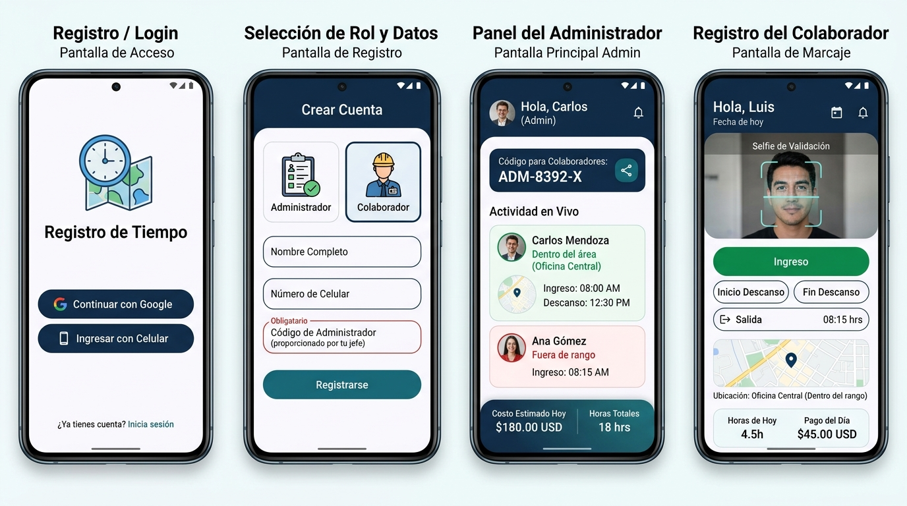

# Registro de Tiempo de Personal (Android)

**Autor y desarrollador:** Juan Abel Reyna Gonzales — Ingeniero Industrial · `abel.reynago@gmail.com`
**Versión:** 1.0.0 · Android 7.0 (API 24) a Android 15 (API 35)

Control de asistencia con validación facial en el dispositivo (sin guardar imágenes), geocercas GPS calculadas con Haversine y cálculo salarial en dos modos: **Simple** (pago por hora para MYPES) y **Avanzado Perú** (planilla, AFP/ONP, 5ta categoría, EsSalud, CTS y gratificaciones).



## Stack

Kotlin · Jetpack Compose (Material 3) · MVVM + Clean Architecture · Hilt · DataStore cifrado con Android Keystore · Firebase (Auth con Google, Firestore, Remote Config, App Check con Play Integrity, Cloud Messaging) · CameraX + ML Kit Face Detection · FusedLocationProvider · Google Maps Compose · Play In-App Updates · R8.

## Estructura

```text
app/src/main/java/com/juanreyna/registrotiempo/
├── data/      # AuthRepository, FirestoreRepository, RemoteConfigRepository, SessionStore (Keystore), FCM
├── domain/    # Modelos, JornadaCalculator, PlanillaPeruCalculator, ResumenMensual, VipAccessManager
├── ui/        # Login, Registro, Admin (Panel/Equipo/Geocerca/Incidencias/Reportes), Colaborador, Ajustes, Acerca de, VIP
└── util/      # GeoUtils (Haversine), LocationValidator (anti-Fake GPS), LivenessAnalyzer, InAppUpdates, ReportExporter, Fechas
app/src/debug|release/…/AppCheckInstaller.kt   # proveedor de App Check por tipo de build
firestore.rules                                 # reglas multi-tenant, inmutabilidad y rate limiting de 60 s
docs/screenshots/                               # capturas de referencia del diseño
```

## Puesta en marcha

1. **Requisitos:** Android Studio reciente (JDK incluido). El proyecto usa Gradle 9.3.1 + AGP 8.13.2 + Kotlin 2.2.20.
2. **Firebase (Plan Spark):**
   - Crea un proyecto en <https://console.firebase.google.com> y agrega la app Android `com.juanreyna.registrotiempo` con la huella SHA-1 de tu firma (`./gradlew signingReport`).
   - Habilita **Authentication → Google**, **Cloud Firestore**, **Remote Config**, **Cloud Messaging** y **App Check** (Play Integrity).
   - Descarga `google-services.json` y colócalo en `app/` (está en `.gitignore`).
   - Publica las reglas: `firebase deploy --only firestore:rules` o pégalas en la consola.
   - En depuración, App Check imprime un token en Logcat: regístralo en *App Check → Administrar tokens de depuración*.
3. **Google Maps:** agrega `MAPS_API_KEY=tu_llave` en `local.properties` y restríngela por paquete + SHA-1 en Google Cloud Console.
4. **Compilar e instalar:**

   ```bash
   ./gradlew :app:testDebugUnitTest   # pruebas del motor de planilla, jornada, Haversine y VIP
   ./gradlew :app:installDebug
   ```

Sin `google-services.json` la app compila y abre una pantalla con estos pasos de configuración.

## Remote Config (muro VIP)

| Parámetro | Valor inicial |
| :-- | :-- |
| `vip_gate_enabled` | `false` |
| `vip_free_trial_days` | `365` |
| `vip_warning_days_before` | `15` |
| `vip_price_monthly_text` | `S/ 29.90 / mes` |
| `vip_price_annual_text` | `S/ 290.00 / año` |
| `vip_promo_message` | `Disfruta de todas las funciones gratis...` |
| `vip_hard_block` | `false` |

La licencia VIP se activa cambiando `empresas/{adminId}.plan` a `"VIP"` desde la consola (las reglas impiden hacerlo desde el cliente).

## Parámetros legales

`ParametrosLegales` (en `PlanillaPeruCalculator.kt`) contiene RMV (S/ 1,130), UIT, tasas ONP/AFP, EsSalud y tramos de 5ta categoría. **Revisa la UIT y las comisiones AFP del año en curso** antes de usar la boleta en producción; los cálculos son referenciales.

## Colecciones de Firestore

`usuarios`, `empresas`, `codigos` (código ADM → adminId), `marcajes` (hora del servidor, distancia, `validacionFacial`), `justificaciones`, `alertas` (GPS falso / fuera de rango). Todas las consultas usan solo filtros de igualdad, así que no hace falta crear índices compuestos.

---

© 2026 Juan Abel Reyna Gonzales - Todos los derechos reservados
